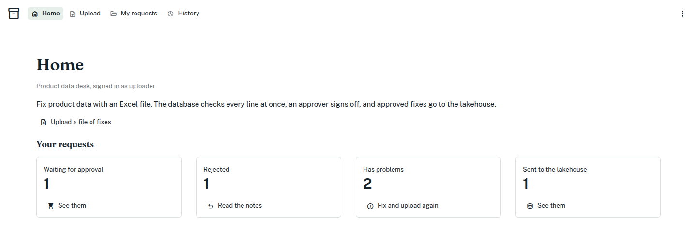

# Lakebase patch desk

**Spark analyzes, PostgreSQL runs the business, and both live in Databricks.**

![Runtime. A person signs in to Databricks and uses a Streamlit app in Databricks Apps, which calls named PostgreSQL operations in Lakebase as the person's own database login. The operations check who asks and the current state, then change tables and events in one transaction. Beyond a line marked "no shared transaction", an export job later publishes approved values to a Delta table governed by Unity Catalog. A dashed AI agent path to the same operations is proposed, its rules tested in SQL only.](docs/images/architecture.svg)

A working Databricks App that keeps its business data in Lakebase, the
managed PostgreSQL inside Databricks. Business users upload Excel files with
data fixes; PostgreSQL checks them at once; a second person approves them;
a job later copies the approved values to a Delta table.

The business rules live in PostgreSQL functions. The app is a thin
Streamlit front end that calls them as the signed-in person, so the database
itself refuses what a person may not do, whatever the user interface shows.
One Declarative Automation Bundle (formerly Databricks Asset Bundle) delivers
the app, the Lakebase project and the jobs, and the database tests run in
every deploy.

The design and its limits are explained in the article
[Beyond Analytics: Building Transactional AI Applications with Databricks and Lakebase](https://alexeyevlampiev.github.io/posts/transactional-ai-applications-databricks-lakebase/).

## What it demonstrates

| Demonstrated | Not demonstrated |
|---|---|
| The human workflow in a Databricks App, connected to Lakebase as the signed-in person | A language model choosing operations |
| Approval rules enforced by PostgreSQL, also outside the app: nobody approves their own change | A remote MCP server and its authentication to Lakebase |
| SQL tests on every deploy; a failing test commits nothing | A two-session test of simultaneous approvals |
| Asynchronous publication of approved data to Delta | Exactly-once or ordered delivery to Delta |



More screenshots: [Upload with the database's checks](docs/images/upload.png),
[My requests](docs/images/my-requests.png),
[Home for an approver](docs/images/home-approver.png),
[History](docs/images/history.png).

## Deploy the demo

The demo runs in your own Azure Databricks workspace, or in a new workspace
and resource group that the deploy script creates.

You need:

- an Azure subscription, the Azure CLI (`az`, signed in with `az login`),
  the Databricks CLI 0.287.0 or later, `curl` and `python3`;
- workspace admin rights (you have them in a workspace the script creates);
- a Microsoft Entra ID app registration with a client secret, made once by
  hand. It becomes the deploy service principal that owns the Lakebase
  project, so no person works as the owner
  ([how](https://learn.microsoft.com/azure/databricks/dev-tools/auth/azure-sp)).

Then:

```bash
cp .env.example .env        # fill in the <...> values; .env is git-ignored
scripts/deploy.sh --create-workspace   # or without the flag, for an existing workspace
```

With `--create-workspace`, the script prints the new workspace's address
as `DATABRICKS_HOST=...`. Put that line in `.env`: every later run of
`deploy.sh` or `teardown.sh` needs it. On Windows use
`scripts/deploy.ps1 -CreateWorkspace`. Both scripts take `--dry-run` to
print the plan without touching anything.

Remove the demo with `scripts/teardown.sh`. It deletes what deploy made,
including the workspace and resource group it created, and keeps only the
identities that live outside the workspace: your Entra app, the two account
groups and the agent's account record. While the demo is up, a stopped app
costs nothing and Lakebase compute costs nothing while suspended.

Details, optional settings (cost alert, usage policy, export catalog) and
what to do when your environment differs: [docs/deploy.md](docs/deploy.md).
A coding agent helping you deploy should read [`AGENTS.md`](AGENTS.md).

## Try the patch desk

The app is called **Product data desk**. On screen, an uploaded file of
fixes is a *change request*; in the code and the database it is a *patch*.
You need two people in the workspace: one uploads, another approves.

1. **Give them access.** Add the uploader to the workspace group
   `patch-desk-uploaders` and the approver to `patch-desk-approvers`, then
   run `scripts/deploy.sh` again: it gives both a database login.
2. **Upload.** The uploader opens the app, goes to **Upload**, clicks
   **Download a sample file** and uploads it. Every line comes back "Fine",
   and the change request waits for approval.
3. **See the checks.** Upload
   [`docs/samples/product-fixes.xlsx`](docs/samples/product-fixes.xlsx):
   four lines are fine and six show a problem each (unknown product,
   unknown field, duplicate line, missing reason, invalid value, unchanged
   value). A file with problems is kept for the record but cannot be
   approved. For a fuller story, upload the three files in
   [`docs/samples/story/`](docs/samples/story/).
4. **Approve.** The approver opens **Review** and approves the clean change
   request. The products change in PostgreSQL at once, in one transaction.
   An approver cannot approve their own request: the app disables the
   button, and the database refuses the call anyway.
5. **Send to the lakehouse.** Start the job `lakebase-patch-desk-patch-export`
   from the workspace's Jobs page, or unpause its 15-minute schedule. It
   merges the approved values into the Delta table
   `<catalog>.patch_desk.product`.

## How it works

- **The app** ([`app/`](app/)) is a thin Streamlit app. Databricks Apps
  forwards the signed-in person's token, and the app asks for the
  `postgres` scope, so it opens a database connection as that person
  ([docs](https://learn.microsoft.com/azure/databricks/dev-tools/databricks-apps/auth)).
  It calls the patch desk's operations inside PostgreSQL through
  `api.rest_invoke`; the logic and the checks live there.
- **The database** ([`db/`](db/)) runs on Lakebase. Each person's database
  login is mapped to that person, row-level security decides what each one
  sees, and people hold no privileges on the tables. Its tests run inside
  every deploy, in the deploy's transaction.
- **The jobs** ([`jobs/`](jobs/), [`resources/`](resources/)): `db_deploy`
  deploys `db/` and gives the members of the two groups their database
  logins; `patch_export` copies approved values to Delta.
- **The bundle** ([`databricks.yml`](databricks.yml), [`resources/`](resources/))
  declares the Lakebase project, both jobs and the app.
- **The scripts** ([`scripts/`](scripts/)) create the workspace if asked,
  run the bundle as the deploy service principal, and tear it all down.

| Path | Start with |
|---|---|
| [`db/`](db/README.md) | the business rules (`core/patch.sql`) and their tests |
| [`app/`](app/README.md) | `streamlit_app.py` and `db.py` |
| [`jobs/`](jobs/README.md) | `patch_desk_job.py` |
| [`resources/`](resources/README.md) | the bundle's resources |
| [`scripts/`](scripts/README.md) | `deploy.sh` and `teardown.sh` |
| [`docs/`](docs/README.md) | deploy details, sources, samples, screenshots |

## Notes

- The database is deployed with [pgmi](https://github.com/vvka-141/pgmi),
  an open-source PostgreSQL deploy tool by the author of this repo, and
  starts from its advanced template. The REST, RPC and MCP dispatchers in
  SQL, `db/gateways/PROTOCOL.md` and the agent skills in `db/.agents/` come
  from that template and stay where it puts them. No MCP client or server is
  tested in this demo; the MCP path is tested in SQL only.
- Platform facts in this repo are backed by the sources in
  [`docs/sources.md`](docs/sources.md), each with the date it was read.
- The repo was built with Claude Code. [`CLAUDE.md`](CLAUDE.md) and
  [`AGENTS.md`](AGENTS.md) hold the rules a coding agent follows here.

## License

MIT. See [LICENSE](LICENSE).
